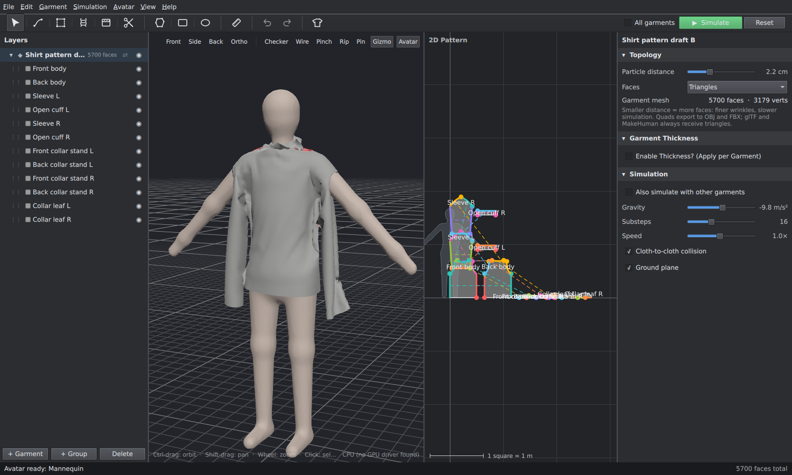

# ATEL-53 alternate recovery checkpoint

- Recorded: 2026-11-15 23:09 UTC
- Order: ATEL-53 (active; standalone shirt, invisible body)
- Lead WorkItem: 051ab175-6f92-42b2-9b39-c912582fd424
- QA WorkItem: 92ff0d6b-d686-441f-889e-55756bafa5a2
- Control read: `quality/studio-control.json`; `activeOrderId=ATEL-53`, `awaitingBrief=false`, only stopped order is ATEL-23. No stopped order was resumed.
- Plan read: `PLAN_STANDALONE.md`; shape is a hard gate before material/artwork, benchmark ATEL-35/v1, no mannequin, inspect six angles.

## Decision

The next distinct route is a garment-specific professional pattern/cloth tool, Marvelous Designer, on its supported Linux environment. Do not resume procedural/bodyPoint, CC0, Blender sewing/proxy, OpenSew2, or Seamstress geometry; preserve all their existing snapshots and evidence. Do not use ATEL-41/v4 or ATEL-47/v4, nor any ATEL-23 artifact, as a base. The local approved-base registry contains only a ready T-shirt base (ATEL-35); it is the wrong garment type for this shirt. Previously inspected ATEL-60 sources were rejected.

This route is selected but cannot execute here yet: Marvelous Designer's official Linux plan requires an Enterprise Team Linux license (currently listed at USD 2,300 per seat/year) and its Linux release supports Rocky Linux 9 / RHEL 9 or equivalent; the current host is Debian 12 and no compatible executable/license is provisioned. No purchase, OS change, or installation is authorized by this checkpoint. Keep ATEL-62, QA, Material, and Visual held until the owner authorizes/provisions the license and compatible runtime, or explicitly accepts a production hold.

Official references checked 2026-11-15:
- https://www.marvelousdesigner.com/pricing
- https://www.marvelousdesigner.com/faq/articles/47358219834649
- https://www.marvelousdesigner.com/support/news/view/0b6e9f44f1da4334bac30e59dbdf23d1

## QA and preserved evidence

The latest independent QA verdict remains `alternate-cc0-shirt-v1.1-gray` = return. Later candidates were self-reviewed and stopped before QA; none passed shape. Latest Seamstress self-review showed detached sleeves/shoulders, fragmented collar, and distorted panels. Its original diagnostic screenshot is preserved at `orders/ATEL-53/seamstress/seamstress-pattern-v1-failed/captures/tool-viewport-self-review.png` (SHA-256 `6ef11247f5872bb75ba3b92a3da81856b58828e5f79c487d8bbccd5ca089e17b`). This is failed-route evidence, not a new candidate or shape handoff.

## Release condition

Resume the same ATEL-62 only after a licensed, supported garment tool/runtime is actually available. Then record a new ETA, create one independent standalone gray candidate, capture six views plus three construction closeups from its immutable snapshot, and send it to Lead review before any QA release. No decoration, retry/verify task, self-ping, or publishing in this checkpoint.
