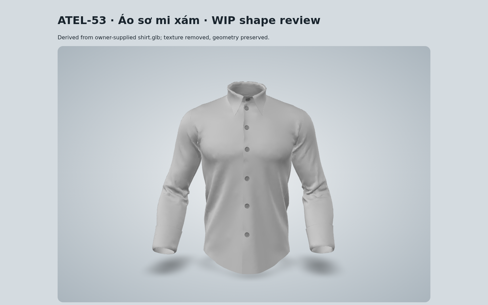
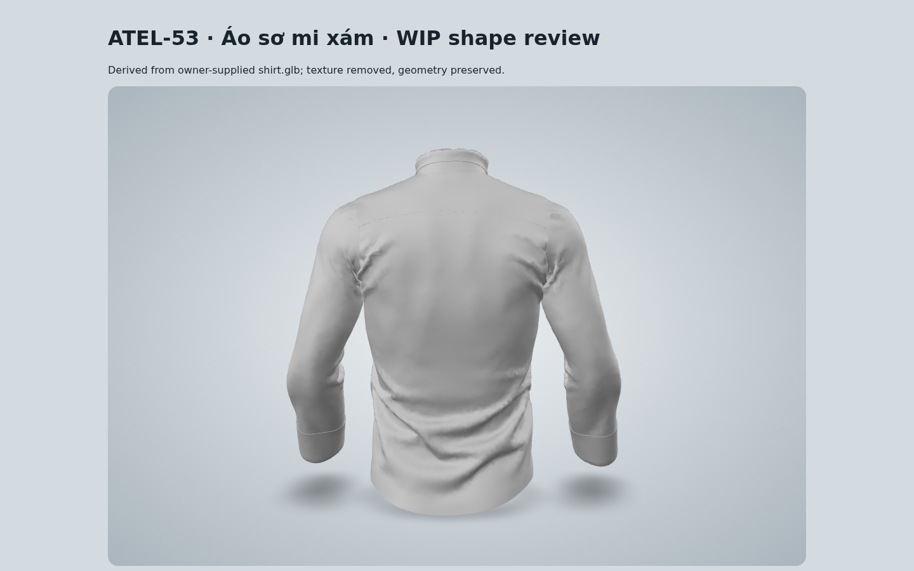
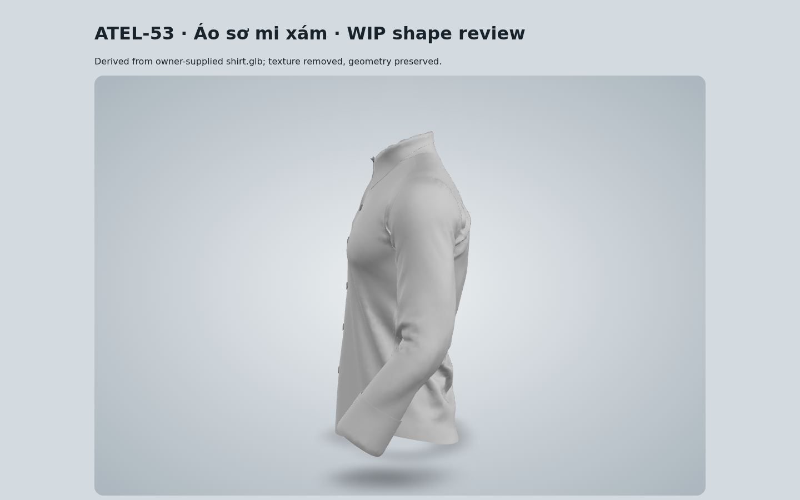
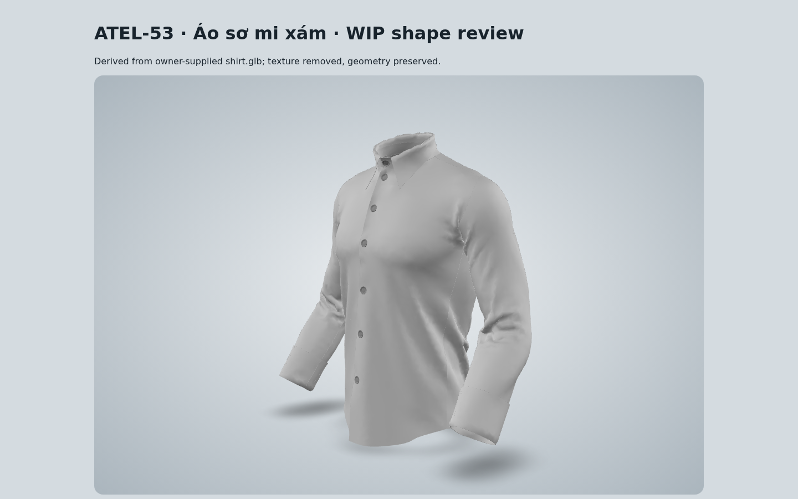
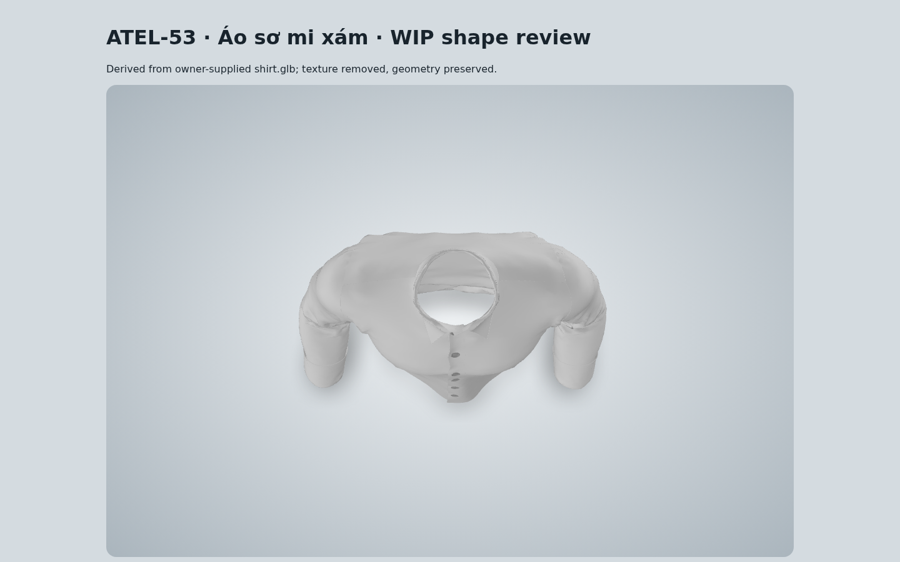
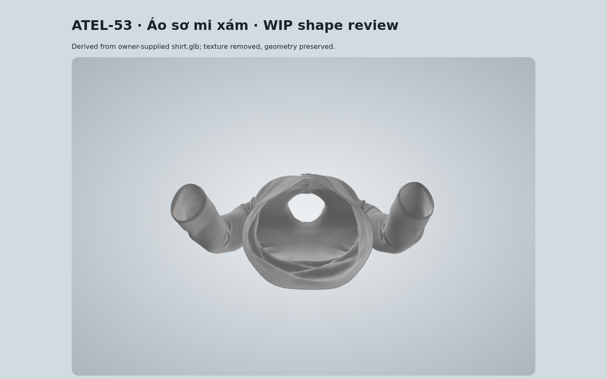
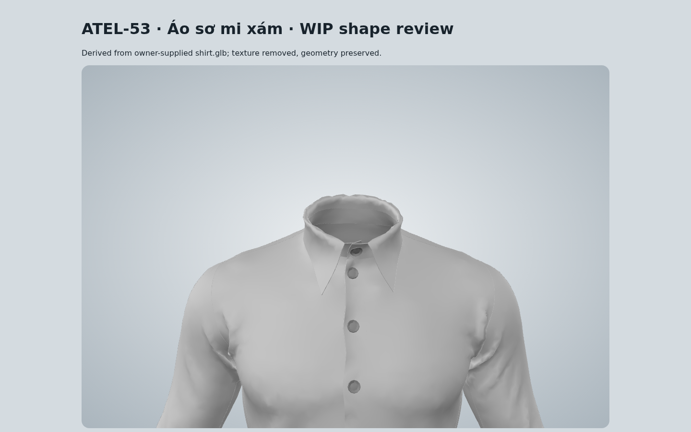
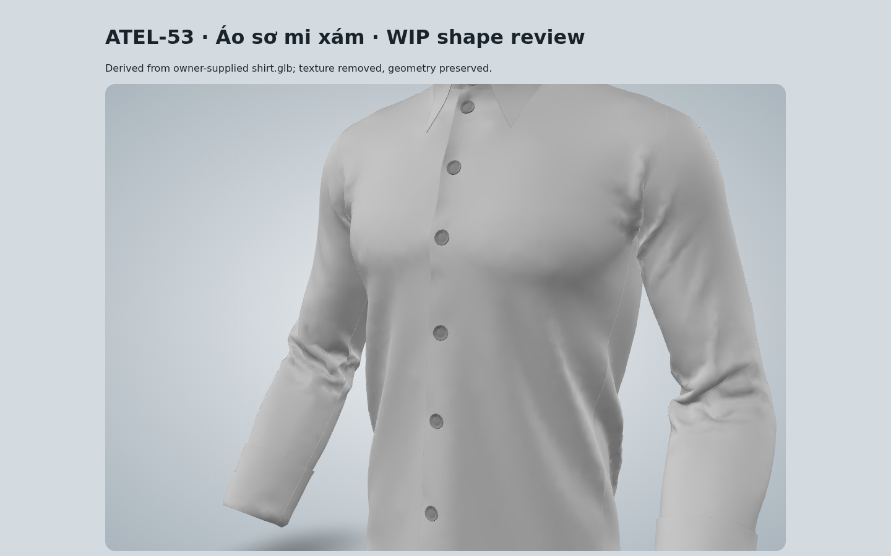
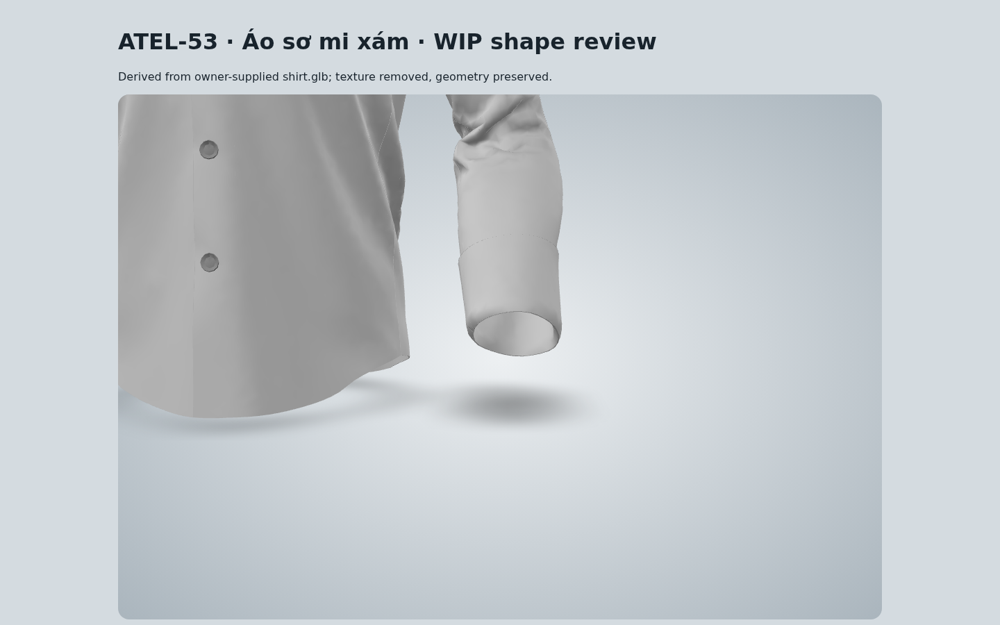

# ATEL-53 checkpoint — QA shape return

Recorded: 2026-11-16 02:41 UTC  
Order: ATEL-53 — Áo sơ mi xanh sọc trắng  
Status: shape returned for a cuff-fastener correction; not approved, not complete, not published.

## Reviewed snapshot

- Revision: `owner-shirt-v1.1-gray`
- GLB: `orders/ATEL-53/owner-shirt-v1.1-gray/shirt-gray-v1.1.glb`
- GLB SHA-256: `dba1bcc1ae6ff2f1a02bbc557eb17bdfc210b2184c39a67f7d665dec2268be13`
- Manifest: `orders/ATEL-53/owner-shirt-v1.1-gray/shape-manifest-v1.1-gray.json`
- Manifest SHA-256: `4b3802758680ac3b9a31a5447122cb4b65375f50cd95a601c7e788a9c539d25f`
- QA report: `quality/reports/ATEL-53/owner-shirt-v1.1-gray.json`
- QA handoff: `orders/ATEL-53/owner-shirt-v1.1-gray/shape-review-handoff.json`
- QA WorkItem: `92ff0d6b-d686-441f-889e-55756bafa5a2` (kept blocked at `studio-wait: shape`)

QA confirmed the 20/20 artifact checks and preview SHA. Drape, collar, openings, and placket pass. Return reason: missing fastener geometry/attachment on both cuffs. No other correction was requested.

## Next action and gates

The same Designer WorkItem, ATEL-62 (`ec090719-14b6-4e75-8615-7260c53cdade`), was released back to its owner for correction. Requested scope is only to add attached cuff fasteners on both cuffs, preserving the existing shirt geometry, collar, placket, folds, and all other details. The v1.1 snapshot remains unchanged. Material and Visual remain on hold until QA passes the gray shape on the existing QA WorkItem. No retry/verify task was created and no publication was made.

## Evidence from the reviewed v1.1 snapshot

Six-angle captures:

Detail captures:

## 2026-11-16 02:51 UTC progress update

Re-read `PLAN_STANDALONE.md` and `quality/studio-control.json`: workflow remains standalone-v9, `activeOrderId` is ATEL-53, and the only stopped order is ATEL-23 (left untouched). Flow status still has `shapeApproved: false`; latest registered shape and shape-review events are `owner-shirt-v1.1-gray`. QA report remains a return for cuff fasteners. Designer confirms v1.2 is a separate snapshot, limited to attached fasteners on both cuffs, with Material/Visual held; no v1.2 handoff or files are present yet. The existing 6-angle and 3-detail evidence above remains the evidence for the returned v1.1 snapshot and is not evidence for v1.2.

The requested Lead WorkItem `051ab175-6f92-42b2-9b39-c912582fd424` is visible as queued and targeted to this session, but a targeted `accept-task` returned 404 `not claimable`; its stored stop/block metadata still contains the superseded pre-owner-base Marvelous Designer blocker. No task or verification item was created. The correction continues on the existing ATEL-62 and QA WorkItem only.

