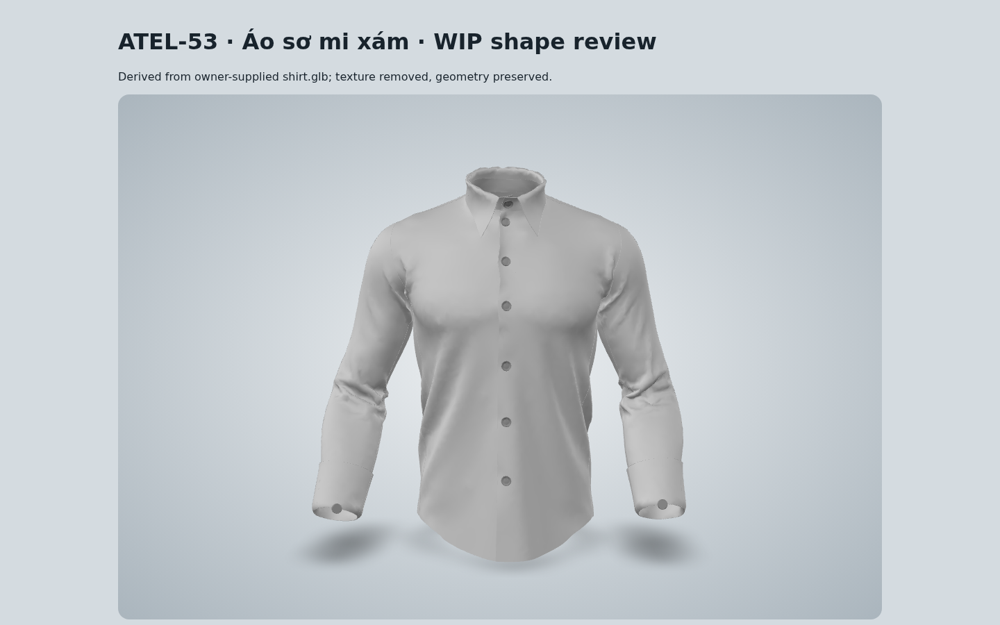
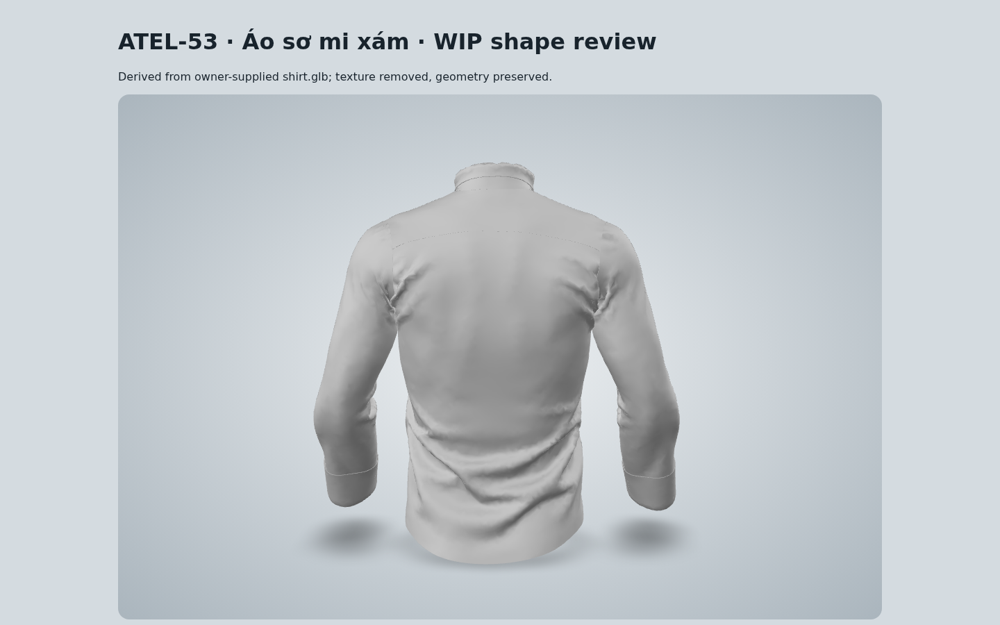
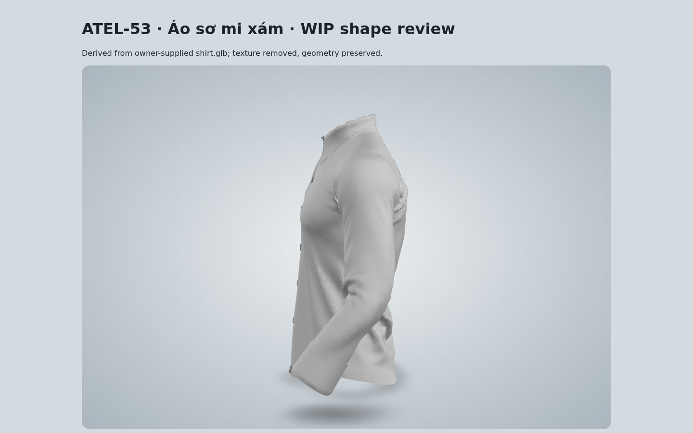
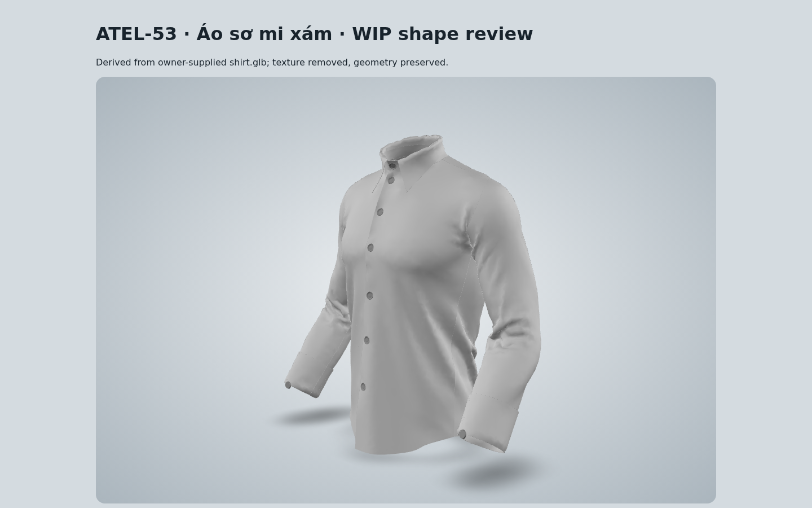
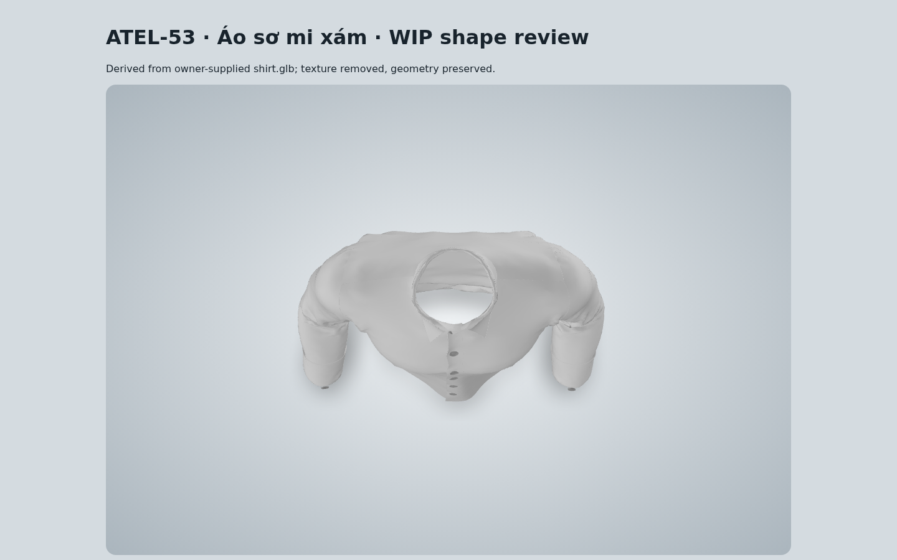
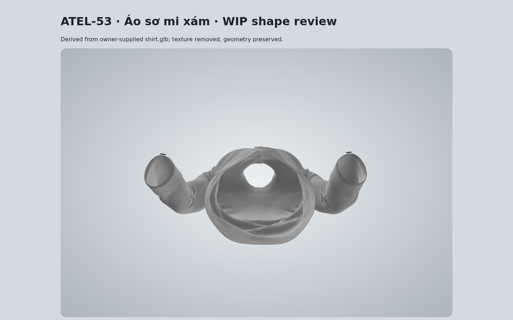
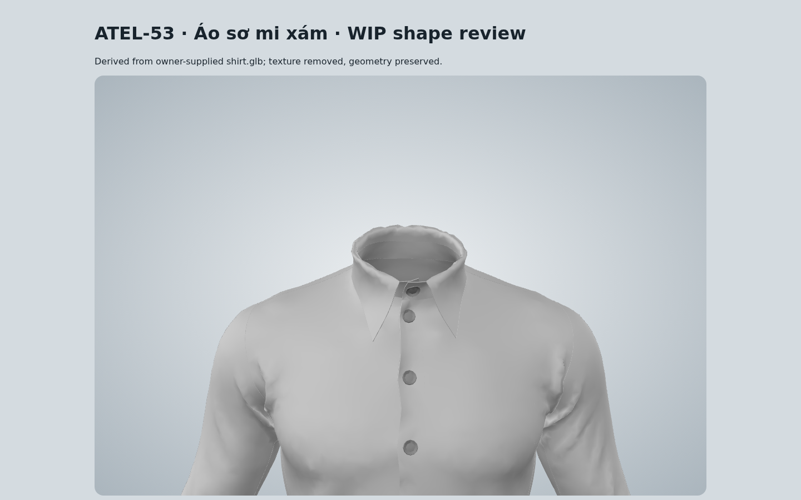
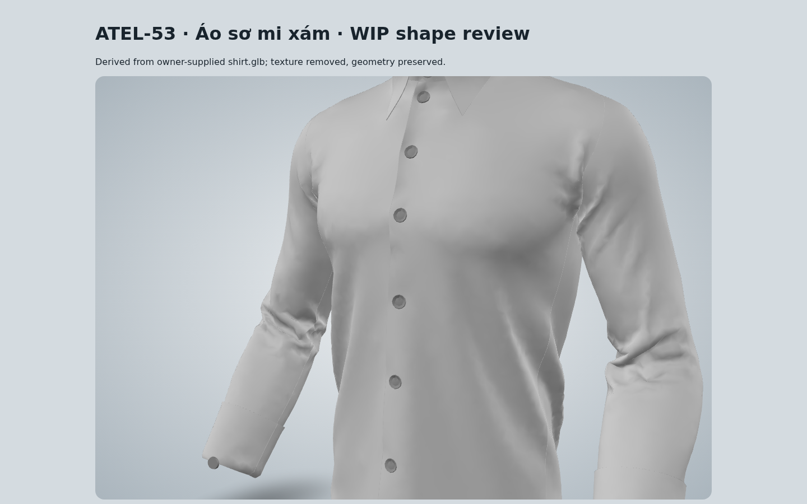
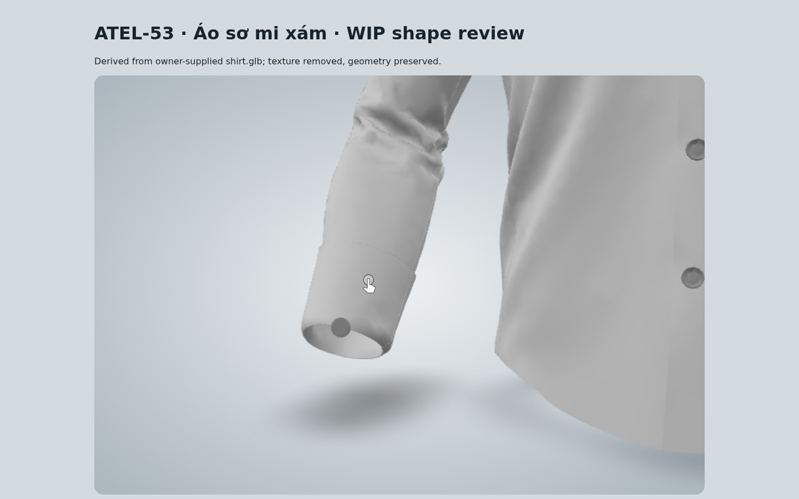
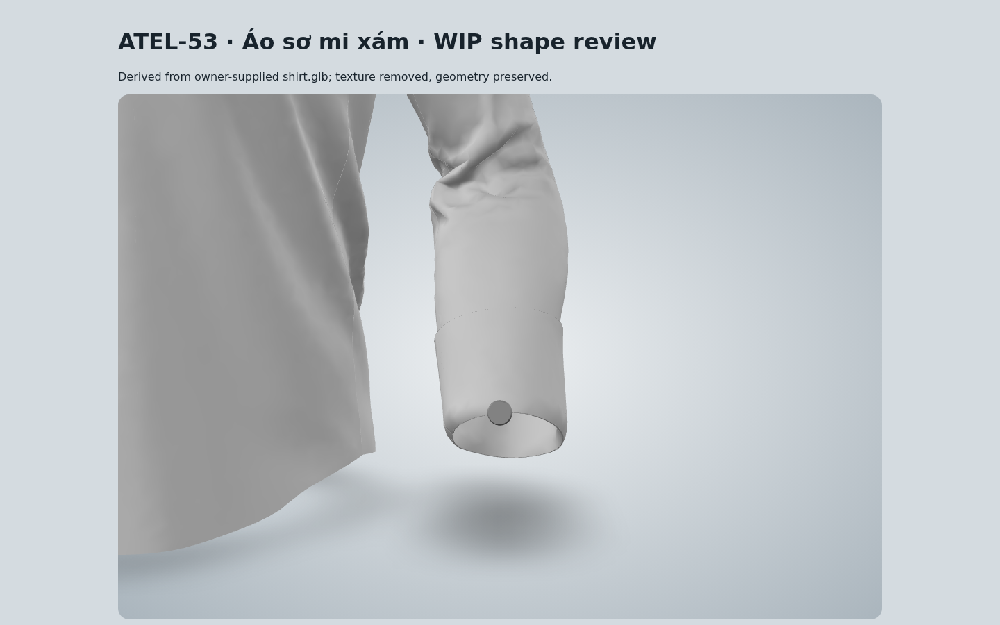

# ATEL-53 checkpoint — v1.2 shape pass

Recorded: 2026-11-16 03:17 UTC  
Order: ATEL-53 — Áo sơ mi xanh sọc trắng  
Order control: standalone-v9; `activeOrderId=ATEL-53`; stopped order ATEL-23 remains untouched.

## Approved gray shape

- Revision: `owner-shirt-v1.2-gray`
- GLB: `orders/ATEL-53/owner-shirt-v1.2-gray/shirt-gray-v1.2.glb`
- SHA-256: `4c9e01ed516f454a96a29fd9f7e7081d659988d1fce536395575cc3b3ce3bc9c` (2,038,132 bytes)
- Shape manifest SHA-256: `90ab22a835886d1585725e5d6b66909071cab232a6cf64c5d438298dade3df05`
- QA report: `quality/reports/ATEL-53/owner-shirt-v1.2-gray.json`
- QA shape-review handoff: `orders/ATEL-53/owner-shirt-v1.2-gray/shape-review-handoff.json`
- QA decision: PASS on the exact GLB SHA above. QA verified 22/22 artifact hashes and byte counts, matching preview hash, six views, and four closeups. Both cuff fasteners are seated; collar, placket, openings and drape pass.
- `studio-flow` reports `shapeApproved=true`; latest event is shape-review v1.2.

## Current downstream state

- Existing Material WorkItem ATEL-56: `893fd790-ff56-4e06-8a94-a13213b0c00b`, running at `atelierx-backend-developer-0005`.
- Existing Visual/viewer WorkItem ATEL-57: `6d973122-6736-4f0b-acdc-bae085e5c56c`, running at `atelierx-designer-0003`.
- At checkpoint time there is no surface artifact and no `surface` event in `studio-flow`; Visual still requires the Material surface GLB and content. QA WorkItem `92ff0d6b-d686-441f-889e-55756bafa5a2` remains `studio-wait: visual` and will do final QA after surface + viewer evidence are handed off.
- Material brief: create a surface revision from the exact approved v1.2 geometry, with bright sky-blue fabric and thin, even vertical white stripes; preserve geometry, transform, UVs, collar/placket/cuff fasteners and all openings. No completion or publication has occurred.

## Captures from the QA-passed v1.2 preview

Six views:

Construction details:

## Viewer readiness update

Designer confirms ATEL-57 is claimed and geometry v1.2 will remain unchanged. Viewer integration ETA is 15 minutes after both surface and content manifests are available. As of this update neither manifest nor a surface artifact/event is present, so Visual work is waiting on Material inputs. No final QA handoff, completion, or publication has occurred.

Material has since reported that surface baking is in progress, with an ETA of about 6 minutes. Filesystem and flow status at 03:18 UTC still show no surface artifact/event; the estimate is not treated as a handoff. Once both Material surface and Research content manifests exist, Visual's 15-minute integration window begins.

